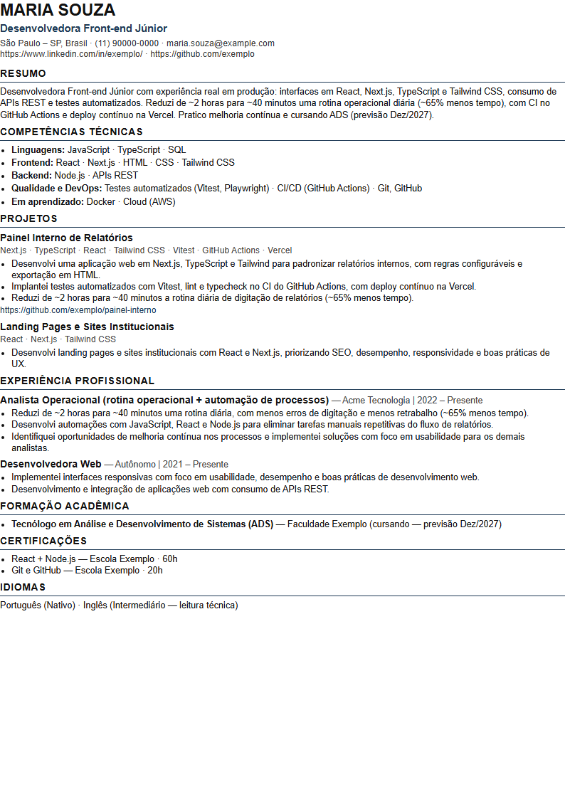

# cv-tailor

> Adapte seu currículo para cada vaga em um comando — com análise de aderência e um
> validador que impede a IA de inventar experiência.

[](https://nodejs.org)
[](https://www.typescriptlang.org)
[](https://github.com/LuizClaudioAds/cv-tailor/actions/workflows/ci.yml)
[](#licença)

`cv-tailor` é uma CLI que pega um currículo base estruturado, uma descrição de vaga e produz:
um currículo de 1 página otimizado para ATS (PDF + DOCX), uma análise honesta de aderência e um
relatório de gaps. A IA escreve; o código confere.

**EN:** A CLI that tailors a structured base résumé to each job posting, exporting an ATS-friendly
PDF/DOCX plus a match analysis — with a validator that blocks fabricated experience, numbers or skills.



_Currículo de exemplo gerado a partir de dados fictícios (`data/profile.example.yaml`)._

---

## Por que existe

Adaptar currículo manualmente para cada vaga é lento e inconsistente. Usar um chatbot "solto" resolve a
velocidade, mas cria outro problema: a IA inventa tecnologias, métricas e até links. Em processo seletivo,
isso é pior do que um currículo genérico.

O `cv-tailor` separa as responsabilidades:

- **LLM** → lê a vaga, escolhe o que destacar e reescreve bullets com as palavras da vaga.
- **Código** → garante que nada disso seja inventado, mede a cobertura de keywords e gera o PDF/DOCX.

## Como funciona

```
npm run cv -- tailor <url | arquivo | ->
        │
        ├─ 1. captura a vaga ................ jobs/<slug>/job.md
        ├─ 2. monta o prompt ................ jobs/<slug>/prompt.md
        ├─ 3. agente OpenCode (headless) .... analysis.md + cv.yaml
        ├─ 4. validador (código) ............ fatos, números, skills, links, idioma, páginas
        ├─ 5. render ........................ cv.md + PDF + DOCX
        └─ 6. relatório ..................... score de match + cobertura de keywords
```

O agente tem permissão de escrita **apenas** em `jobs/**`. Ele não altera o perfil, não roda shell
e não acessa a internet.

## Instalação

```bash
git clone https://github.com/LuizClaudioAds/cv-tailor.git && cd cv-tailor
npm install

# PDF via Chromium: usa Edge/Chrome instalado ou o cache do Playwright
npx playwright install chromium   # só se necessário

# comando global opcional
npm link
```

Requisitos: Node 22+ e [OpenCode](https://opencode.ai) autenticado (é o motor de IA).

## Início rápido

```bash
# 1. copie os exemplos e preencha com seus dados
cp data/profile.example.yaml      data/profile.yaml
cp data/keywords.example.yaml     data/keywords.yaml
cp data/preferences.example.yaml  data/preferences.yaml

# 2. confira o que o agente vai poder usar
npm run cv -- profile validate
npm run cv -- profile show

# 3. gere o CV para uma vaga
npm run cv -- tailor https://link-da-vaga
```

Saída:

```
Cobertura de keywords da vaga: 83%
  Ausentes: Jest, Figma
Validacao de fatos: OK

Curriculo: jobs/acme-desenvolvedor-front-end-junior
  - maria-souza-desenvolvedora-front-end-junior-acme.pdf
  - maria-souza-desenvolvedora-front-end-junior-acme.docx
```

## Comandos

| Comando                     | O que faz                                                                   |
| --------------------------- | --------------------------------------------------------------------------- |
| `import-cv <arquivo>`       | Extrai o texto de um CV `.docx`/`.pdf` para `data/base/cv.txt`              |
| `profile validate [--file]` | Valida o schema do perfil e a unicidade dos ids                             |
| `profile show [--section]`  | Mostra o perfil como texto, com os ids de cada bullet                       |
| `keywords [--job <vaga>]`   | Lista o banco ATS ou compara a vaga com o perfil (o que falta)              |
| `tailor <vaga>`             | Pipeline completo: análise + CV + PDF/DOCX                                  |
| `tailor --dry-run`          | Monta `job.md` + `prompt.md` sem chamar a IA (auditoria)                    |
| `fix <slug>`                | Reenvia o CV reprovado ao agente com o relatório do validador               |
| `inbox [--dir vagas]`       | Processa todas as vagas `.md`/`.txt` de uma pasta, sem repetir as já feitas |
| `check <slug>`              | Revalida fatos, keywords e número de páginas                                |
| `export <slug>`             | Re-renderiza PDF/DOCX/MD a partir do `cv.yaml`                              |
| `preview <slug>`            | Gera `preview.png` para revisar o layout                                    |
| `list`                      | Lista candidaturas com score de match                                       |

Flags úteis do `tailor`: `--lang pt|en`, `--cover` (carta de apresentação), `--model provider/modelo`,
`--dry-run`.

## Anatomia de uma candidatura

```
jobs/acme-desenvolvedor-front-end-junior/
├── job.md            texto da vaga + origem + idioma + data
├── prompt.md         prompt exato enviado ao agente (auditoria)
├── analysis.md       requisitos × evidência, gaps, keywords, riscos, score
├── cv.yaml           currículo estruturado (editável à mão)
├── cv.md             versão Markdown (LinkedIn/Gupy)
├── <Nome>-<Cargo>-<Empresa>.pdf
├── <Nome>-<Cargo>-<Empresa>.docx
└── preview.png       gerado por `cvtailor preview`
```

### O `analysis.md`

```md
**Score de match:** 84/100
**Recomendação:** candidatar-se com ajustes

## O que a vaga pede

- React — obrigatório — proj-1, exp-2 — ✅
- Testes (Jest ou Vitest) — desejável — proj-2 (Vitest) — ⚠️ Jest ausente
- Scrum — desejável — sem evidência — ❌

## Gaps

- Scrum — impacto: cerimônias citadas — sugestão: estudar e citar vivência em Kanban

## Riscos

- Cargo atual não é dev: posicionamento com projetos no topo e métrica de impacto
```

## O perfil (fonte única da verdade)

`data/profile.yaml` guarda **todo** fato do candidato: identidade, resumo PT/EN, skills por grupo,
projetos (com repo/demo), experiências, formação, certificações, idiomas e uma lista de `facts`
(números permitidos).

```yaml
experience:
  - id: acme
    company: Acme
    role: Analista de Dados
    period: { start: 2022, current: true }
    bullets:
      - id: acme-1
        text: Reduzi de 2h para 40min uma rotina diária com uma aplicação em React e Node.js.
```

Cada bullet tem um `id`. O CV gerado referencia esses ids — é isso que torna a auditoria possível.

## Banco de keywords ATS

`data/keywords.yaml` organiza as palavras-chave em níveis, para nunca haver exagero:

| Nível        | Regra                                                        |
| ------------ | ------------------------------------------------------------ |
| `core`       | você tem de verdade — entra em qualquer vaga da área         |
| `fortes`     | você tem, mas só entra se a vaga citar                       |
| `aprendendo` | aparece apenas no grupo "Em aprendizado", nunca como domínio |
| `pendente`   | falta confirmar — o agente não usa                           |
| `soft`       | exige `evidence` (id de bullet) para poder entrar            |

`aliases` resolvem variações (`Node.js` / `NodeJS`), e o match respeita limite de palavra —
`Java` não casa dentro de `JavaScript`.

```bash
npm run cv -- keywords --job vaga.md
```

```
CORE (sempre usar)
  [x] JavaScript      [x] React      [x] APIs REST
FORTES (usar se a vaga citar)
  [x] Vitest          [ ] Jest
Cobertura do perfil: 23/25 (92%)
Faltam no perfil: Jest, Comunicação
```

## Validação anti-alucinação

O CV é **reprovado** (e o agente recebe o relatório para corrigir) quando:

- cita número inexistente no perfil (métricas, percentuais, cargas horárias);
- altera empresa, cargo ou período;
- referencia bullet, projeto, formação ou certificação que não existe;
- adiciona tecnologia fora do perfil (exceto no grupo "Em aprendizado");
- usa link de projeto diferente do `repo`/`demo` cadastrado;
- contém placeholder (`{{ }}`, `TODO`) ou HTML cru;
- marca `lang: en` e deixa texto em português;
- passa do limite de páginas configurado.

```bash
npm run cv -- fix <slug>   # devolve o relatório ao agente e re-renderiza
```

## Testes

```bash
npm test
```

Cobrem o núcleo do projeto:

- **validador anti-alucinação** — número inventado, empresa trocada, período errado, skill fora do perfil,
  tecnologia "em aprendizado" usada como domínio, bullet de outro projeto, link não cadastrado,
  placeholder, projeto/certificação inexistente, CV em inglês com texto em português;
- **motor de keywords** — `Java` não casa dentro de `JavaScript`, aliases e acentos, limite de palavra,
  cálculo de cobertura.

O CI roda typecheck, testes, build e valida o perfil de exemplo a cada push.

## Desenvolvimento

```bash
npm run lint          # ESLint (flat config + typescript-eslint)
npm run format        # Prettier --write
npm run format:check  # o que o CI usa
npm run typecheck
npm test
npm run build
```

Hooks: `npm install` já aponta o Git para `.githooks/`. O `pre-commit` **bloqueia** commit de
`data/profile.yaml`, `preferences.yaml`, `keywords.yaml`, `data/base/`, `jobs/`, `vagas/`, `.env`
e arquivos `.pdf`/`.docx` — uma segunda camada além do `.gitignore`.

## Configuração

| Arquivo                         | Papel                                                                   |
| ------------------------------- | ----------------------------------------------------------------------- |
| `data/profile.yaml`             | fatos do candidato (**não versionado**)                                 |
| `data/preferences.yaml`         | pretensão, disponibilidade, idioma padrão, máx. de páginas, tom, modelo |
| `data/keywords.yaml`            | banco ATS por níveis                                                    |
| `prompts/tailor.md`             | regras de escrita e schema do `cv.yaml`                                 |
| `.opencode/agents/cv-tailor.md` | agente headless (escrita restrita a `jobs/**`)                          |

## Inbox: várias vagas de uma vez

Crie a pasta `vagas/` (ignorada pelo Git) e salve cada descrição como `.md` ou `.txt`:

```
vagas/
├── acme-frontend-junior.md
├── globex-estagio-backend.txt
└── initech-fullstack.md
```

```bash
npm run cv -- inbox                 # processa o que ainda não foi feito
npm run cv -- inbox --limit 3       # no máximo 3 por execução
npm run cv -- inbox --retry-failed  # tenta de novo as que deram erro
npm run cv -- inbox --cover --lang en
```

O progresso fica em `vagas/.processadas.json` (hash do conteúdo). Se você editar o arquivo da vaga,
o hash muda e ela é processada de novo. Vagas com erro ficam registradas e não repetem automaticamente.

## Modelo de IA

O **agente** é sempre o `cv-tailor` (definido em `.opencode/agents/cv-tailor.md`) — a CLI não muda isso.
O **modelo** é resolvido nesta ordem:

1. `--model provider/modelo` na linha de comando;
2. `model:` em `data/preferences.yaml`;
3. o modelo padrão configurado no OpenCode.

Importante: `opencode run` **não** herda o modelo selecionado na sessão do TUI. Se você está no chat com
outro modelo, a CLI continua usando o padrão do OpenCode — a menos que você defina um dos dois acima.

```yaml
# data/preferences.yaml
model: anthropic/claude-sonnet-5-5#high
```

Por execução: `--model provider/modelo`.

## Limitações (honestas)

- **ATS não é ciência exata.** O PDF é de uma coluna, com texto selecionável e títulos canônicos,
  mas cada ATS pontua diferente. Sempre revise o texto final.
- **LinkedIn e alguns portais bloqueiam leitura automática.** Nesses casos, salve a vaga em `.md`
  e rode `tailor vaga.md`.
- **O validador garante que nada foi inventado; ele não garante que o texto ficou bom.** Leia o PDF
  antes de enviar — `cvtailor preview` ajuda.
- O agente pode gastar 1–3 minutos por vaga.

## Roadmap

- [ ] `tailor --inbox`: processar uma pasta `vagas/` em lote
- [ ] `cover-letter.md` como padrão (hoje é `--cover`)
- [ ] Suporte a currículo em inglês com `profile.en.yaml`
- [ ] Integração com Gupy/LinkedIn (aplicação assistida)
- [ ] Testes de render (PDF/DOCX) com fixtures

## Privacidade

`data/profile.yaml`, `data/preferences.yaml`, `data/base/` e `jobs/` estão no `.gitignore`.
O repositório traz apenas `*.example.yaml` com dados fictícios. Nenhum dado sai da sua máquina além
do que é enviado ao modelo do OpenCode durante a geração.

## Licença

MIT. Veja [LICENSE](LICENSE).
